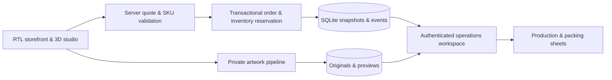

# Konj · کُنج

**A Persian RTL commerce platform with interactive 3D product customization.**

Konj brings a Three.js product studio into a full-stack shopping workflow. Customers can explore apparel, mugs and stickers, position artwork on products, choose valid variants and complete a recoverable test checkout. An authenticated operations workspace connects each order to its original artwork, production specifications and packing sheets.

The visual direction combines gothic and metal influences with burgundy curtains, geometric flooring inspired by the Red Room, local ornamental SVGs and smoked-glass controls.

## Engineering highlights

- **Interactive product studio** — shared product previews across the storefront and editor, garment deformation, camera controls, front/back artwork placement, size measurements and a sticker layout editor.
- **Authoritative pricing and inventory** — server-side quotes, SKU validation, transactional stock reservations and immutable order snapshots.
- **Recoverable checkout** — idempotent order creation, request recovery after uncertain responses, cross-tab coordination and reservation expiry.
- **Private artwork pipeline** — validated image bytes, separate original and preview files, ownership checks, streaming downloads, quotas and bounded processing.
- **Operations workspace** — versioned admin edits, conflict-aware drafts, order events, production exports and printable packing sheets.
- **Security and recovery** — scrypt password hashing, session revocation, origin checks, rate limits, isolated HTTP fixtures and verified backup/restore drills.

## Stack and architecture

| Layer | Implementation |
| --- | --- |
| Application | Next.js App Router, React, TypeScript |
| Presentation | Persian RTL, local Vazirmatn font, CSS and Tailwind tooling |
| 3D | Three.js, product geometry, texture placement and interactive deformation |
| Persistence | SQLite transactions and private files on persistent disk |
| Verification | Node.js test runner, isolated HTTP scenarios, production restart and recovery drills |



The application targets a single Node.js instance with a persistent local volume. Prices use integer toman amounts. Customer uploads are served through authorization checks.

## Run locally

Requires **Node.js 24** and npm.

```powershell
git clone https://github.com/Omidf28/konj.git
cd konj
npm ci
$env:APP_ORIGIN='http://127.0.0.1:3000'
npm run dev -- --hostname 127.0.0.1 --port 3000
```

Open [the storefront](http://127.0.0.1:3000) or [the admin workspace](http://127.0.0.1:3000/admin). The browser origin must match APP_ORIGIN, including hostname and port.

Create an administrator from an interactive terminal.

```powershell
npm run admin:create -- your_admin_name
```

The password is entered with masking. Account recovery, environment configuration and production operations are documented in [Operations](docs/OPERATIONS.md) and [Admin security](docs/ADMIN_SECURITY.md).

## Verification

```powershell
npm run lint
npm run typecheck
npm test
npm run test:http:isolated
npm run build
```

The public edition passes **255 regression tests** covering commerce, geometry and application state. HTTP acceptance covers storefront routes, private files, pricing, order/payment idempotency, tracking, admin workflows and account security using synthetic data. See [HTTP testing](docs/HTTP_TESTING.md) for the isolated acceptance workflow.

## Project status

This is a working portfolio project with a test commerce flow. Catalog data and commercial policies are samples. Live payments, shipping providers and production hosting require integration and acceptance. Test payments are blocked in production. Device performance, physical print validation and remaining visual checks are tracked in the roadmap.

The 3D previews are illustrative. This public edition uses code-generated garment geometry and excludes the restricted third-party hoodie mesh and private development history. The MakeHuman reference asset and Vazirmatn font retain their original license notices. No repository-wide open-source license is granted by this README.

## Explore the code

| Area | Location |
| --- | --- |
| Routes and server-rendered pages | [src/app](src/app) |
| Storefront and admin components | [src/components](src/components) |
| Geometry, editor and browser state | [src/lib](src/lib) |
| Pricing, orders, security and storage | [src/server](src/server) |
| Regression tests | [tests](tests) |
| Isolated acceptance and maintenance tools | [scripts](scripts) |
| Remaining work and acceptance gates | [Release checklist](RELEASE_CHECKLIST.md) |

## درباره پروژه

کُنج یک پروژه فول‌استک فروشگاهی برای نمایش مهارت در توسعه Next.js، طراحی تجربه فارسی راست‌چین، پیش‌نمایش سه‌بعدی، مدیریت سفارش و حفاظت از فایل مشتری است. مسیر سفارش از انتخاب محصول و طرح تا تولید و بسته‌بندی پیاده شده و با داده ساختگی آزمایش می‌شود. وضعیت واقعی پذیرش و وابستگی‌های عرضه در نقشه راه ثبت شده است.
